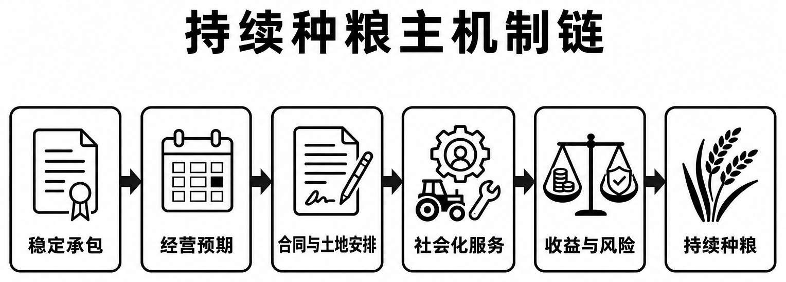
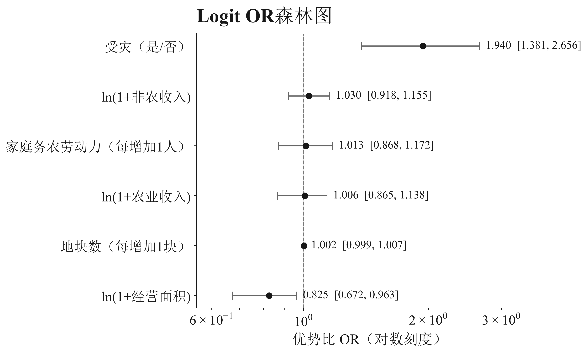

**简体中文** · [English](README.en.md)

# 把地种好，把日子过稳

### 安徽农户持续种粮调研项目

土地承包稳定之后，农户还需要什么，才能把地持续种下去？本项目从家庭劳动力、土地与合同、社会化服务和收益风险出发，研究安徽农户的经营处境，以及县域治理可以回应的具体问题。

**淮南师范学院 · 青穗江淮调研团**

[在线阅读报告](https://hnnuyuxuan.github.io/anhui-rural-survey/report/) · [在线阅读 Notebook](https://hnnuyuxuan.github.io/anhui-rural-survey/notebook/) · [研究文库](https://hnnuyuxuan.github.io/anhui-rural-survey/) · [查找数据与图表](data/README.md) · [引用本项目](CITATION.md)

报告提供章节导航、公式与图表；Notebook 保留完整计算输出，支持展开代码和下载复现。[报告源码](report/report.md) · [Notebook 源文件](notebooks/analysis.ipynb) · [调查工具](surveys/README.md)



*研究框架：从稳定承包到持续经营。图中箭头表达研究机制，具体统计证据见报告。*

## 三组资料，一条研究主线

| 年份 | 调查对象 | 样本 | 研究重点 | 数据入口 |
|:---:|:---|---:|:---|:---:|
| 2025 | 农户 | 2,079&nbsp;户 | 经营条件与撂荒关联 | [主实证](data/README.md) |
| 2026 | 农户 | 570&nbsp;户 | 政策、合同与托管服务 | [农户指标](data/results/households-2026.csv) |
| 2026 | 村级 | 38&nbsp;村 | 合同、服务与基础设施 | [村级指标](data/results/villages-2026.csv) |

2025 年资料承担主实证，2026 年农户与村级资料提供并列观察。各题项使用各自的有效分母；样本设计、模型假设与研究局限见[报告](report/report.md)与[数据说明](DATA.md)。

## 从结果进入研究

2025 年有效回答中，**8.23%** 报告存在撂荒。主 Logit 模型采用 **2,055 户**完整案例；控制家庭与经营条件后，受灾对应的撂荒优势比为 **1.940**，95% bootstrap 区间为 **1.381–2.656**。这些数值描述条件关联，具体变量、分母与估计方法见[模型结果表](data/results/fallow-model-2025.csv)。



*图 4-3　2025 年撂荒模型优势比。配套[制图数据](data/charts/fig4-3_logit_or.csv)与[敏感性检验](data/results/sensitivity-2025.csv)可用于进一步核对。*

研究由此延伸到合同规范、关键农时服务和灾后恢复：土地权利的稳定如何转化为家庭经营的稳定？[完整报告](report/report.md)沿研究背景、方法、主实证、农户画像、2026 年证据与县域治理逐章展开。

## 选择你的使用方式

| 使用目的 | 阅读入口 | 主要内容 |
|:---|:---|:---|
| 理解问题与结论 | [报告导览](report/README.md) | 八章正文、研究框架与结论 |
| 核对数字与比例 | [复现指南](docs/usage.md) | Notebook、24 个数据文件与核对方法 |
| 查找数据与图表 | [图表索引](figures/README.md) | 11 组统计图、5 张逻辑图及制图数据 |
| 设计类似调查 | [调查工具](surveys/README.md) | 农户与村干部问卷（DOCX、TXT） |
| 追溯来源与引用 | [参考文献](references/README.md) · [引用](CITATION.md) | 来源登记、引用格式与作者信息 |
| Agent 检索与接手 | [Agent 指南](docs/agent-guide.md) · [llms.txt](llms.txt) | 机器目录、证据定位与维护流程 |

## 本地开始

```bash
git clone https://github.com/HNNUYUXUAN/anhui-rural-survey.git
cd anhui-rural-survey
python scripts/verify_release.py
python scripts/build_discovery.py --check
```

以上核验只需 Python 3.11 或兼容版本的标准库。重新执行 Notebook：

```bash
conda env create -f environment.yml
conda run -n anhuirural-survey python scripts/build_analysis_notebook.py --execute
```

Notebook 读取聚合统计、模型输出与制图数据，复核比例、重绘核心结果并检查文件间一致性。个体层模型重估所需的数据条件见 [DATA.md](DATA.md)；pip 安装、运行位置与输出说明见[使用指南](docs/usage.md)。

## 团队、引用与贡献

本项目由淮南师范学院青穗江淮调研团完成。[项目背景](ABOUT.md)介绍调研主题与活动来源，[作者信息](AUTHORS.md)列出成员和指导教师。

研究材料版本为 **v1.0.0（2026-09-14）**。引用时使用 [CITATION.md](CITATION.md) 或 [CITATION.cff](CITATION.cff)，并记录所用提交与文件校验值。仓库维护记录见 [CHANGELOG.md](CHANGELOG.md)。

软件脚本采用 **AGPL-3.0-only**，原创研究内容与公开数据采用 **CC BY-SA 4.0**；具体适用范围见 [LICENSE](LICENSE)。欢迎通过 [Issue](https://github.com/HNNUYUXUAN/anhui-rural-survey/issues) 反馈问题，提交修改前请阅读[贡献指南](CONTRIBUTING.md)。
