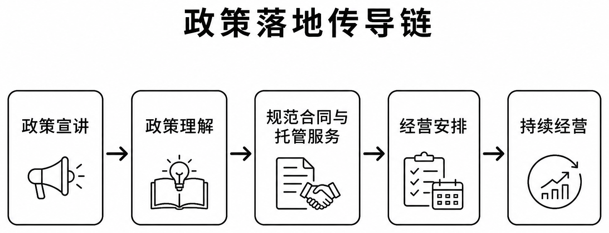

# 图表与制图数据

统计图提供 PNG 与 SVG 两种格式；PNG 便于阅读，SVG 便于缩放。每组统计图附对应 CSV，图号与[研究报告](../report/README.md)一致。

## 统计图

| 图表 | PNG | SVG | 数据 |
|---|---|---|---|
| 图 1-2 安徽城乡居民人均可支配收入 | [查看](stats/fig1-2_ah_urban_rural_income.png) | [矢量图](stats/fig1-2_ah_urban_rural_income.svg) | [CSV](../data/charts/fig1-2_ah_urban_rural_income.csv) |
| 图 4-1 土地状态 | [查看](stats/fig4-1_land_status.png) | [矢量图](stats/fig4-1_land_status.svg) | [CSV](../data/charts/fig4-1_land_status.csv) |
| 图 4-2 劳动力与撂荒 | [查看](stats/fig4-2_labor_fallow.png) | [矢量图](stats/fig4-2_labor_fallow.svg) | [CSV](../data/charts/fig4-2_labor_fallow.csv) |
| 图 4-3 撂荒模型优势比 | [查看](stats/fig4-3_logit_or.png) | [矢量图](stats/fig4-3_logit_or.svg) | [CSV](../data/charts/fig4-3_logit_or.csv) |
| 图 4-4 经营面积与受灾预测情景 | [查看](stats/fig4-4_area_disaster_prediction.png) | [矢量图](stats/fig4-4_area_disaster_prediction.svg) | [CSV](../data/charts/fig4-4_area_disaster_prediction.csv) |
| 图 5-2 农户画像特征热图 | [查看](stats/fig5-2_profile_heatmap.png) | [矢量图](stats/fig5-2_profile_heatmap.svg) | [CSV](../data/charts/fig5-2_profile_heatmap.csv) |
| 图 5-3 画像指标 | [查看](stats/fig5-3_profile_metrics.png) | [矢量图](stats/fig5-3_profile_metrics.svg) | [CSV](../data/charts/fig5-3_profile_metrics.csv) |
| 图 6-2 政策认知与未来安排 | [查看](stats/fig6-2_policy_future.png) | [矢量图](stats/fig6-2_policy_future.svg) | [CSV](../data/charts/fig6-2_policy_future.csv) |
| 图 6-3 合同、服务与约束 | [查看](stats/fig6-3_contract_service_constraints.png) | [矢量图](stats/fig6-3_contract_service_constraints.svg) | [CSV](../data/charts/fig6-3_contract_service_constraints.csv) |
| 图 6-4 村级治理 | [查看](stats/fig6-4_village_governance.png) | [矢量图](stats/fig6-4_village_governance.svg) | [CSV](../data/charts/fig6-4_village_governance.csv) |
| 图 6-5 户村并列指标 | [查看](stats/fig6-5_household_village_parallel.png) | [矢量图](stats/fig6-5_household_village_parallel.svg) | [CSV](../data/charts/fig6-5_household_village_parallel.csv) |

## 研究框架与逻辑图

*图 6-1　政策宣讲、政策理解、合同与托管服务如何进入经营安排。*

- [图 1-1 持续种粮主机制链](diagrams/fig1-1_grain_continuity_mechanism.png)
- [图 3-1 实证分析流程](diagrams/fig3-1_empirical_workflow.png)
- [图 5-1 农户画像分类](diagrams/fig5-1_profile_classification.png)
- [图 6-1 政策落地传导链](diagrams/fig6-1_policy_transmission.png)
- [图 7-1 风险与恢复机制](diagrams/fig7-1_risk_recovery_loop.png)

复用时保留图题、单位、样本口径与来源；修改图形或数据后注明修改内容，并按[许可证](../LICENSE)署名与共享。

[返回首页](../README.md)
