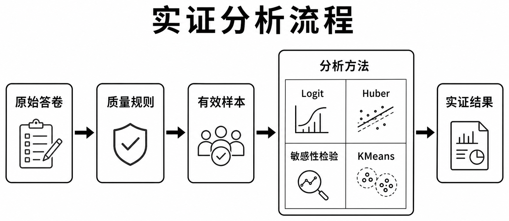

# 研究报告

## 把地种好，把日子过稳

**稳定承包背景下安徽农户持续种粮的约束结构**

[在线阅读全文](https://hnnuyuxuan.github.io/anhui-rural-survey/report/) · [Markdown 源文件](report.md) · [复核结果](../notebooks/README.md) · [查看图表](../figures/README.md)

报告以 2025 年 2079 户为主实证，以 2026 年 570 户和 38 村为并列证据，从家庭经营处境讨论持续种粮与县域治理。

| 章节 | 阅读重点 |
|---|---|
| 一、研究背景与问题 | 稳定承包、土地流转与农业社会化服务 |
| 二、数据基础与分析框架 | 三套资料、有效分母与证据定位 |
| 三、模型构建与统计方法 | Logit、稳健回归、敏感性与画像方法 |
| 四、2025 年主实证结果 | 土地状态、劳动力、规模与灾害关联 |
| 五、农户画像与分类接口 | 家庭经营处境与服务需求 |
| 六、2026 年农户端与村级端证据 | 政策认知、合同、托管和治理供给 |
| 七、从约束结构到县域治理 | 合同、关键农时服务与灾后恢复 |
| 八、结论与研究局限 | 主要判断及其适用范围 |

*图 3-1　报告的实证分析流程。公开结果的复核路径见[使用指南](../docs/usage.md)。*

[数据口径](../DATA.md) · [参考文献](../references/README.md) · [引用格式](../CITATION.md) · [返回首页](../README.md)
